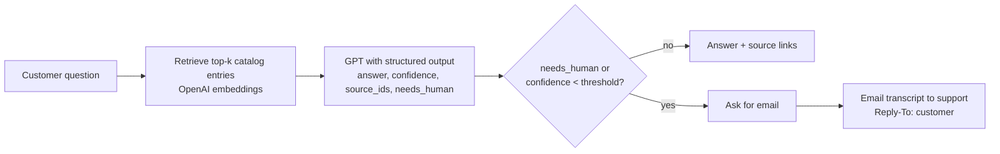

# Shopify FAQ Chatbot

A store support bot that answers customer questions from a Shopify product catalog, and hands the conversation to a person by email when it isn't sure.

Small online stores get the same questions every day: "Is this in stock?", "Do you ship to Canada?", "Which grind do I need?". A general chatbot can answer these, but it will also make up prices and policies with total confidence. This bot answers **only from the store's own catalog JSON**. For every answer the model reports how well the catalog supports it, and a confidence gate decides whether the customer sees the answer or gets an email form that sends the full conversation to the support inbox.


## How it works



- **Catalog → documents.** [app/catalog.py](app/catalog.py) turns each product (with variants, prices, sale prices and stock), policy and FAQ into one LangChain `Document`. Products use the same shape as Shopify's public `/products.json`, so a real store's catalog can be dropped in.
- **Retrieval.** Documents are embedded once at startup into an `InMemoryVectorStore`. For follow-up questions ("and the steel one?"), the previous question is added to the search query.
- **Structured answer.** The model must return `BotReply` (`answer`, `confidence`, `source_ids`, `needs_human`) through `with_structured_output`, so the confidence gate never has to parse free text.
- **Confidence gate.** [app/bot.py](app/bot.py) hands off when the model flags `needs_human` (order status, refunds, complaints, "can I talk to someone") or when `confidence` is below `CONFIDENCE_THRESHOLD` (default 0.7). If the model call itself fails, that's handed off too, so the customer never sees a 500 error.
- **Grounded sources.** Source ids the model cites are checked against what was actually retrieved, so a made-up id can never show up as a link.
- **Email handoff.** [app/handoff.py](app/handoff.py) emails the question and transcript to `SUPPORT_EMAIL`, with `Reply-To` set to the customer so support can answer with one click. Each handoff can only be sent once. If SMTP isn't configured, emails are written to `outbox/` as `.eml` files.

## Tech stack

- Python 3.12, FastAPI, Uvicorn
- LangChain (`langchain-core`, `langchain-openai`), OpenAI GPT and `text-embedding-3-small`
- Plain HTML/CSS/JS chat UI (no build step)
- Docker Compose with [Mailpit](https://mailpit.axllent.org/) as a local inbox for handoff emails
- pytest, using fake embeddings and a fake model (no API key needed)

## Run it

### Docker (recommended)

```bash
cp .env.example .env        # then set OPENAI_API_KEY
docker compose up --build
```

- Chat: http://localhost:8000
- Handoff inbox (Mailpit): http://localhost:8025

### Locally

```bash
python -m venv .venv
source .venv/bin/activate          # Windows: .venv\Scripts\activate
pip install -r requirements-dev.txt
cp .env.example .env               # then set OPENAI_API_KEY
uvicorn app.main:create_app --factory --reload
```

With `SMTP_HOST` left empty, handoff emails are saved to `outbox/`.

### Tests

```bash
pytest
```

## Try these

| Question | Expected behavior |
| --- | --- |
| Is the brushed steel kettle in stock? | Answers "out of stock" (Matte Black is available) and links the product |
| Do you ship to Canada? How long does it take? | Answers from the shipping policy: flat $19, 7-14 business days |
| Which grind should I buy for a French press? | Coarse, pointing to the grind FAQ and Cold Brew Coarse Grind |
| Do you sell matcha? | Not in the catalog → low confidence → email handoff |
| Where is my order #1042? | Needs order lookup → `needs_human` → email handoff |

## Use your own store

Edit [data/catalog.json](data/catalog.json), or pull the products from a live Shopify storefront:

```bash
python scripts/import_shopify_products.py your-store.myshopify.com
```

This replaces `products` and keeps your `store`, `policies` and `faqs`. Restart the app to re-embed the catalog.

## API

| Method | Path | Body | Returns |
| --- | --- | --- | --- |
| `POST` | `/api/chat` | `{ "message", "session_id"? }` | `{ session_id, answer, confidence, handoff, handoff_reason, sources[] }` |
| `POST` | `/api/handoff` | `{ "session_id", "email" }` | `{ status, message }`; `409` if there's nothing to hand off |
| `GET` | `/api/config` | | Store name, suggested questions, support email |
| `GET` | `/api/health` | | `{ status, documents }` |

## Configuration

All settings come from environment variables or `.env`. See [.env.example](.env.example).

| Variable | Default | Purpose |
| --- | --- | --- |
| `OPENAI_API_KEY` | (required) | OpenAI key |
| `OPENAI_MODEL` | `gpt-4.1-mini` | Chat model |
| `EMBEDDING_MODEL` | `text-embedding-3-small` | Embedding model |
| `CONFIDENCE_THRESHOLD` | `0.7` | Answers below this go to a person |
| `RETRIEVAL_K` | `4` | Catalog entries sent to the model per question |
| `SUPPORT_EMAIL` / `FROM_EMAIL` | example addresses | Handoff recipient and sender |
| `SMTP_HOST`, `SMTP_PORT`, `SMTP_USER`, `SMTP_PASSWORD`, `SMTP_STARTTLS` | empty / 587 / on | SMTP server; empty host writes to `outbox/` |

## Limitations

- Sessions and the vector index live in memory, so this runs as a single process. For more than one worker, move sessions to Redis and the index to pgvector or similar.
- The confidence score is the model's own rating of how well the retrieved context covers the question. That works well for "is this in the catalog?", but it isn't a calibrated probability. Tune `CONFIDENCE_THRESHOLD` against real questions.
- Stock levels are only as fresh as the last catalog import.

The sample store, Driftwood Coffee Co., is made up.

## sort entries

Updated implementation details.

## subscribe topic

Updated implementation details.

## create session

Updated implementation details.

## sort entries

Updated implementation details.

## subscribe topic

Updated implementation details.

## create session

Updated implementation details.